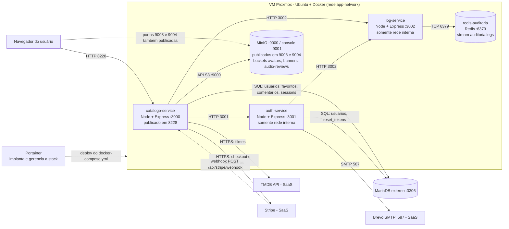
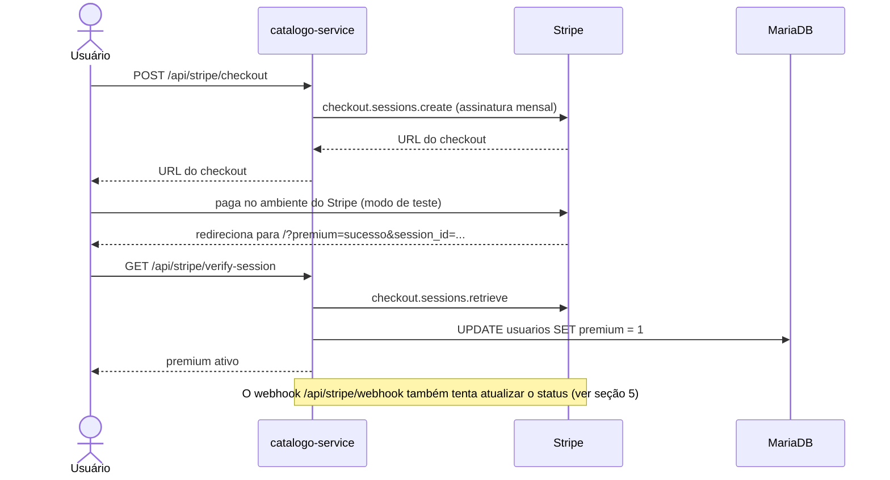
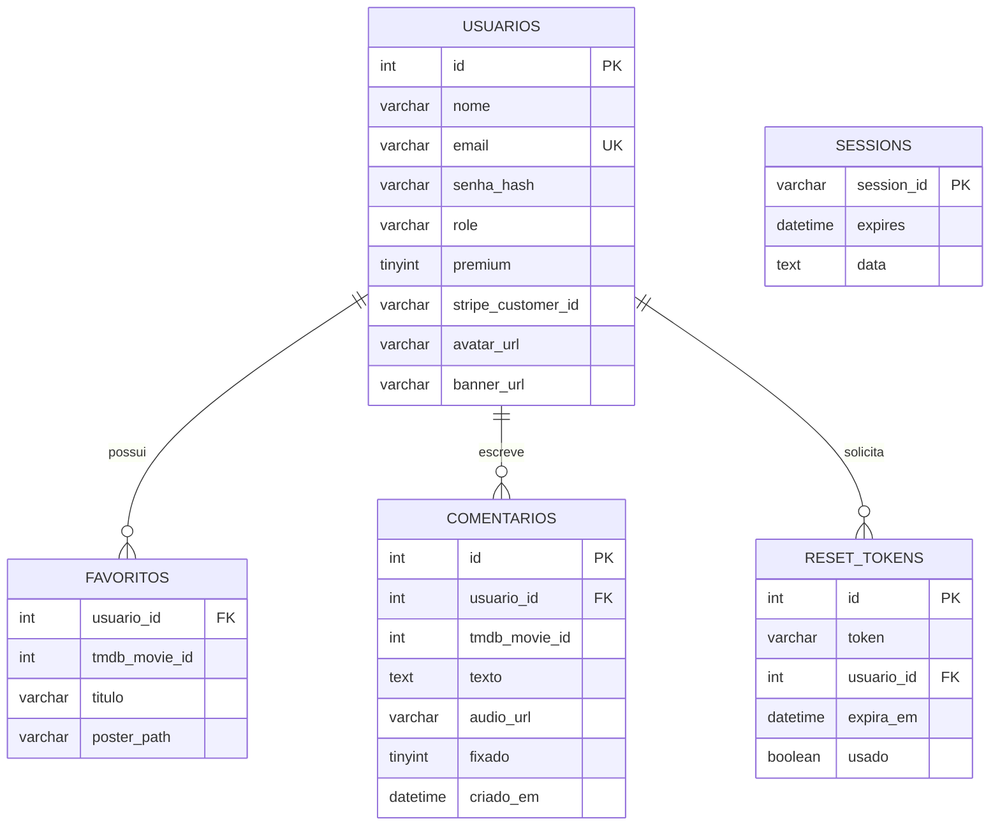

# Documentação reversa — Catálogo Tom Hanks

> Documento escrito **lendo o código** do repositório, como se o sistema tivesse sido herdado de outra pessoa sem nenhuma documentação (Atividade 8 — ISW055).
> Convenção das referências: `arquivo › rota ou função`. Quando algo foi **inferido** (por exemplo, o esquema do banco, que não tem DDL no repositório), isso vem indicado. Quando algo **não existe** no código, o texto diz isso explicitamente.
> Nenhum segredo é reproduzido aqui: apenas os **nomes** das variáveis de ambiente.

## Sumário

1. [Especificação](#1-especificação)
2. [Arquitetura](#2-arquitetura)
3. [Regras de negócio](#3-regras-de-negócio)
4. [Modelo de dados](#4-modelo-de-dados)
5. [Pontos de atenção e divergências](#5-pontos-de-atenção-e-divergências)

## Mapa do repositório

| Caminho | O que é |
|---|---|
| `catalogo-service/server.js` | API pública (única porta exposta): sessão, RBAC, proxy para o Auth, TMDB, favoritos, comentários, Stripe, MinIO, painel admin |
| `catalogo-service/public/index.html` | Interface principal (catálogo, favoritos, comentários, modal Premium, gravação de áudio, painel admin) |
| `catalogo-service/public/perfil.js` | Menu de perfil, troca de senha, selo VIP, banner, bio (guardada no navegador) |
| `catalogo-service/public/auth.html` e `reset-password.html` | Telas de login/cadastro e de redefinição de senha |
| `catalogo-service/public/app.js` | **Legado**: não é carregado por nenhuma página (ver seção 5) |
| `auth-service/server.js` | Microsserviço interno de cadastro, login, recuperação e troca de senha |
| `log-service/server.js` | Microsserviço interno de auditoria sobre Redis Streams |
| `docker-compose.yml` e `.env.example` | Orquestração dos containers e lista de variáveis de ambiente |
| `docs/P1_ISW055_Yago_Martins.pdf` | Relatório de uma atividade anterior |

---

## 1. Especificação

### 1.1 Visão geral

O sistema é um catálogo web dos filmes de Tom Hanks (dados vindos da API do TMDB). Depois de autenticado, o usuário navega pelos filmes, marca favoritos, escreve comentários (texto e, para assinantes, áudio) e gerencia o próprio perfil. Existe um **plano Premium (VIP)** pago via Stripe em modo de teste e um **painel administrativo** de moderação e auditoria. Toda a interface é servida pelo próprio `catalogo-service`.

### 1.2 Perfis e permissões

| Capacidade | Visitante | Usuário comum | Premium | Admin |
|---|:--:|:--:|:--:|:--:|
| Cadastrar-se, entrar, recuperar senha | sim | — | — | — |
| Ver catálogo de filmes | não | sim | sim | sim |
| Favoritar / desfavoritar | não | sim | sim | sim |
| Comentar em texto | não | sim | sim | sim |
| Ver comentários de um filme | não | só os próprios | só os próprios | todos |
| Apagar comentário | não | só os próprios | só os próprios | qualquer um |
| Foto de perfil (avatar) | não | até 1 MB | até 10 MB | até 10 MB |
| Banner de perfil | não | não | sim | sim |
| Crítica em áudio (até 15 s) | não | não | sim | sim |
| Destaque nos comentários (topo, selo VIP, moldura dourada) | — | não | sim | sim |
| Assinar / cancelar Premium | não | sim | sim | sim (já tem VIP pelo papel) |
| Moderação (todos os comentários) e logs de auditoria | não | não | não | sim |

O papel `admin` recebe automaticamente todos os recursos VIP (`catalogo-service/server.js › isPremiumOrAdmin`). Não existe rota para promover alguém a admin: o cadastro sempre cria `usuario`, então o papel `admin` só pode ser atribuído diretamente no banco.

### 1.3 Funcionalidades, do ponto de vista de quem usa

**Cadastro e login.** O visitante informa nome, e-mail e senha. Depois do login, a sessão dura 24 horas. Cadastro, login, "esqueci a senha" e redefinição têm limite de tentativas.

**Recuperação de senha.** O usuário informa o e-mail e, se ele existir, recebe uma mensagem com um link válido por 30 minutos e de uso único. A tela mostra sempre a mesma mensagem, exista ou não o e-mail.

**Catálogo.** Lista os filmes em que Tom Hanks atuou (TMDB, pessoa 31, em português).

**Favoritos.** O usuário marca e desmarca filmes. Os favoritos são individuais e não há limite de quantidade, nem para usuário comum.

**Comentários.** Em cada filme o usuário escreve comentários de texto. Usuário comum enxerga apenas os seus; o admin enxerga todos e pode apagar qualquer um. Comentários de admin e de assinantes aparecem primeiro, com selo VIP e moldura dourada. Assinantes também podem gravar uma crítica em áudio de até 15 segundos direto pelo microfone.

**Perfil.** O usuário troca a foto (armazenada no MinIO), altera a senha e, se for Premium/Admin, envia um banner. A bio é salva **apenas no navegador** (`localStorage`), não no servidor.

**Plano Premium.** O botão Premium abre um modal com os benefícios (R$ 19,90/mês). O pagamento acontece no ambiente do Stripe. Ao voltar para o sistema, a assinatura é verificada e o usuário vira VIP. Também é possível sincronizar uma assinatura já paga e cancelar o plano.

**Painel do administrador.** Duas abas: moderação (últimos 100 comentários de todos os usuários, com opção de apagar) e logs de auditoria (consulta e exclusão de eventos).

### 1.4 Limites e valores configurados no código

| Item | Valor | Onde |
|---|---|---|
| Duração da sessão | 24 h | `catalogo-service/server.js › session` |
| Tentativas em register/login/forgot/reset | 20 por 15 min (por IP) | `authLimiter` |
| Custo do bcrypt | 12 | `auth-service/server.js` |
| Tamanho mínimo da senha nova | 6 caracteres | `auth-service`, `catalogo-service` |
| Validade do token de recuperação | 30 min, uso único | `auth-service › /forgot-password` |
| Avatar | 1 MB (comum), 10 MB (premium/admin) | `/api/perfil/avatar` |
| Banner | 10 MB (premium/admin) | `/api/perfil/banner` |
| Áudio | 15 s no gravador do navegador + teto de 512 KB no servidor | `/api/comentarios/audio` |
| Preço do plano | R$ 19,90/mês (usado se `STRIPE_PRICE_ID` estiver vazio) | `/api/stripe/checkout` |
| Consulta de logs | padrão 100, máximo 500 | `log-service › GET /logs` |
| Painel de moderação | últimos 100 comentários | `/api/admin/comentarios` |

---

## 2. Arquitetura

### 2.1 Diagrama geral

### 2.2 Componentes

| Componente | Tecnologia | Porta | Exposição | Responsabilidade |
|---|---|---|---|---|
| `catalogo-service` | Node 20 + Express | 3000 (host 8228) | **Pública** | Interface web, sessão, RBAC, TMDB, favoritos, comentários, Stripe, MinIO, painel admin, proxy de rotas de autenticação |
| `auth-service` | Node 20 + Express | 3001 | Interna | Cadastro, login (bcrypt), tokens de recuperação, e-mail via Brevo, troca de senha |
| `log-service` | Node 18 + Express | 3002 | Interna | Grava, lista e apaga eventos de auditoria no Redis |
| `redis-auditoria` | Redis (alpine) | 6379 | Interna | Guarda o stream `auditoria:logs` |
| `minio` | MinIO | 9000 / 9001 (host 9003 / 9004) | Interna **e publicada no host** | Armazena avatares, banners e áudios |
| MariaDB | MariaDB | 3306 | Externo ao Compose | Usuários, favoritos, comentários, tokens e sessões |
| TMDB | API REST | HTTPS | Externo | Fonte dos filmes |
| Stripe | API REST + webhook | HTTPS | Externo | Cobrança da assinatura (modo de teste) |
| Brevo | SMTP | 587 | Externo | Envio do e-mail de recuperação |
| Portainer | Interface web de gerenciamento do Docker | — | Fora do código do projeto | Hospeda o projeto na web: implanta a stack a partir do `docker-compose.yml`, guarda as variáveis de ambiente e permite reiniciar, atualizar e ver os logs dos containers |

Todos os containers da aplicação ficam na rede Docker `app-network`. O `catalogo-service` é o único ponto de entrada da aplicação: ele chama o Auth e o Log pelo nome do container (`auth-service-yago`, `log-service-yago`).

### 2.3 Variáveis de ambiente (apenas nomes)

| Variável | Usada por | Para quê |
|---|---|---|
| `TMDB_API_KEY` | catálogo | Consultar filmes |
| `DB_HOST`, `DB_USER`, `DB_PASSWORD`, `DB_NAME`, `DB_PORT` | catálogo, auth | Conexão com o MariaDB |
| `SESSION_SECRET` | catálogo | Assinar o cookie de sessão |
| `AUTH_SERVICE_URL`, `LOG_SERVICE_URL` | catálogo (e `LOG_SERVICE_URL` no auth) | Endereços internos dos microsserviços |
| `STRIPE_SECRET_KEY`, `STRIPE_PUBLISHABLE_KEY`, `STRIPE_WEBHOOK_SECRET`, `STRIPE_PRICE_ID` | catálogo | Integração com o Stripe |
| `APP_URL` | catálogo, auth | URL pública usada nos redirecionamentos do checkout e no link de recuperação |
| `MINIO_ENDPOINT`, `MINIO_PORT`, `MINIO_PORT_PUBLIC`, `MINIO_ACCESS_KEY`, `MINIO_SECRET_KEY` | catálogo, compose | Acesso ao armazenamento de objetos |
| `SMTP_HOST`, `SMTP_PORT`, `SMTP_USER`, `SMTP_PASS` | auth | Envio de e-mail pelo Brevo |
| `REDIS_URL`, `PORT` | log | Conexão com o Redis e porta do serviço |

### 2.4 Fluxos típicos

**Login.** Navegador → `POST /api/auth/login` no catálogo (limite de tentativas) → `POST /login` no Auth → consulta `usuarios` no MariaDB e compara com bcrypt → o Auth envia o evento ao Log → o catálogo grava `{id, nome, email, role}` na sessão (tabela `sessions`) e devolve o cookie `session_cookie`.

**Upload de avatar.** Navegador (`salvarFotoPerfilMinio`) → `POST /api/perfil/avatar` (multipart) → o catálogo valida login, tipo e tamanho → `putObject` no bucket `avatars` do MinIO → grava `/api/storage/avatars/<objeto>` em `usuarios.avatar_url` → registra o evento `upload_avatar`. Para exibir, o navegador pede `GET /api/storage/avatars/<objeto>` e o catálogo repassa o arquivo vindo do MinIO.

**Crítica em áudio.** Gravador do navegador (`MediaRecorder`, para sozinho aos 15 s) → `POST /api/comentarios/audio` → `premiumMiddleware` → validação de formato e tamanho → `putObject` no bucket `audio-reviews` → `INSERT` em `comentarios` com `audio_url` → evento `criar_comentario_audio`.

**Checkout Premium.**

**Recuperação de senha.** Navegador → `POST /api/auth/forgot-password` → Auth gera token (32 bytes), grava em `reset_tokens` e envia o link pelo Brevo → usuário abre `reset-password.html?token=...` → `POST /api/auth/reset-password` → Auth valida token (não usado e não expirado), atualiza `senha_hash` e marca o token como usado.

**Consulta de logs (admin).** Navegador → `GET /api/logs?limit=100` → `adminMiddleware` → Log (`GET /logs`) → Redis (`XREVRANGE`) → lista devolvida ao painel.

### 2.5 Implantação (Portainer)

O projeto é hospedado na web pelo **Portainer**, a partir do `docker-compose.yml`: a stack sobe cinco containers (`catalogo-service`, `auth-service`, `log-service`, `redis-auditoria` e `minio`). O Portainer não aparece no código do repositório. Ele é a ferramenta de implantação, não um componente da aplicação.

O que isso implica, a partir dos arquivos do repositório:

- **Variáveis de ambiente.** O Compose lê os segredos com `${...}` e o `.env` está no `.gitignore`, então todas as variáveis da seção 2.3 precisam estar cadastradas no ambiente da stack no Portainer (o `.env.example` lista os nomes). `APP_URL` deve conter a URL pública do site, porque ela é usada no retorno do checkout e no link de recuperação de senha.
- **Build das imagens.** Os três serviços usam `build: ./<serviço>`, ou seja, o código vira imagem na hora da implantação. Por isso a stack precisa ter acesso aos fontes (por exemplo, implantação a partir do repositório Git), e não apenas a imagens prontas.
- **Atualizações.** Publicar uma mudança exige atualizar a stack e reconstruir as imagens.
- **Webhook do Stripe.** O endereço `/api/stripe/webhook` precisa ser configurado no painel do Stripe com a URL pública do site (ver o ponto 1 da seção 5.1).
- **Persistência.** Só o MinIO tem volume (`minio_data`); apagar a stack sem preservá-lo apaga avatares, banners e áudios. O Redis não tem volume (ver o ponto 14 da seção 5.1).

---

## 3. Regras de negócio

Formato: **SE** condição **ENTÃO** consequência (`origem`). Todas foram extraídas do código.

### 3.1 Cadastro, login e sessão

- **SE** nome, e-mail ou senha faltam no cadastro, **ENTÃO** a resposta é 400 (`auth-service › POST /register`).
- **SE** o cadastro é aceito, **ENTÃO** o papel é sempre `usuario`, qualquer campo `role` enviado no corpo é ignorado, o nome e o e-mail são aparados (`trim`), o e-mail vai para minúsculas e a senha é guardada como hash bcrypt de custo 12 (`POST /register`).
- **SE** o e-mail já existe, **ENTÃO** a resposta é 409 "E-mail já cadastrado" (o banco rejeita a duplicidade) (`POST /register`).
- **SE** o login chega sem e-mail ou senha, **ENTÃO** a resposta é 400 (`POST /login`).
- **SE** o e-mail não existe **OU** a senha não confere, **ENTÃO** a resposta é a mesma, 401 "Credenciais inválidas", e um evento `login_falha` é registrado (`POST /login`).
- **SE** o login é válido, **ENTÃO** o catálogo guarda `id`, `nome`, `email` e `role` na sessão e emite o cookie `session_cookie` (`catalogo-service › POST /api/auth/login`).
- **SE** o cookie é emitido, **ENTÃO** ele é `HttpOnly`, `SameSite=Lax`, dura 24 h e a sessão é guardada no MariaDB (`express-mysql-session`). O segredo vem de `SESSION_SECRET`; se a variável não existir, o código usa um valor padrão fixo (`catalogo-service/server.js › session`).
- **SE** há mais de 20 chamadas em 15 min vindas do mesmo IP em register, login, forgot-password ou reset-password, **ENTÃO** a resposta é 429 (`authLimiter`). A troca de senha autenticada não passa por esse limitador.
- **SE** a rota exige login e não há sessão, **ENTÃO** a resposta é 401 "Faça login." (`authMiddleware`).
- **SE** o front consulta `/api/auth/me`, **ENTÃO** `role`, `premium`, `avatar_url`, `banner_url` e `stripe_customer_id` são relidos do banco e atualizados na sessão; admin sempre sai como `premium = 1` (`GET /api/auth/me`).
- **SE** o usuário faz logout, **ENTÃO** o evento `logout` é registrado, a sessão é destruída e o cookie é apagado (`POST /api/auth/logout`).

### 3.2 Recuperação e troca de senha

- **SE** o e-mail não é informado, **ENTÃO** 400 (`POST /forgot-password`).
- **SE** o e-mail não existe, **ENTÃO** a resposta é a mesma mensagem genérica do caso de sucesso e nada é enviado nem registrado em log (`POST /forgot-password`).
- **SE** o e-mail existe, **ENTÃO** é criado um token aleatório (32 bytes em hexadecimal) com validade de 30 minutos, o link é enviado por SMTP (Brevo) e o evento `solicitacao_recuperacao_senha` é registrado.
- **SE** a redefinição chega com token ausente ou senha com menos de 6 caracteres, **ENTÃO** 400 (`POST /reset-password`).
- **SE** o token não existe, já foi usado ou expirou, **ENTÃO** 400 e o evento `reset_senha_falha` é registrado.
- **SE** o token é válido, **ENTÃO** a senha é trocada (bcrypt 12), o token é marcado `usado` e o evento `senha_redefinida` é registrado.
- **SE** o usuário logado troca a própria senha, **ENTÃO** o catálogo usa o `id` da **sessão** (nunca um `id` vindo do cliente), exige 6 caracteres ou mais e registra `senha_alterada`. A rota **não pede a senha atual** (`POST /api/auth/change-password`).

### 3.3 Controle de acesso (RBAC)

- **SE** a rota é de administrador e não há sessão, **ENTÃO** 401 (`adminMiddleware`).
- **SE** a rota é de administrador e o papel não é `admin`, **ENTÃO** 403 e o evento `tentativa_negada_403` é registrado com o método e a URL tentados.
- **SE** a rota é de recurso VIP e o usuário não é premium nem admin, **ENTÃO** 403 (`premiumMiddleware`). O status premium é lido do banco a cada chamada, não da sessão.
- **SE** o usuário é `admin`, **ENTÃO** ele tem os recursos VIP sem precisar assinar (`isPremiumOrAdmin`).

### 3.4 Catálogo e favoritos

- **SE** o usuário está logado, **ENTÃO** `/api/filmes` consulta no TMDB os créditos da pessoa 31 em pt-BR e devolve a lista `cast`; falha do TMDB vira 500 (`GET /api/filmes`).
- **SE** o usuário lista favoritos, **ENTÃO** recebe apenas os seus (filtro por `usuario_id` da sessão) (`GET /api/favoritos`).
- **SE** o usuário favorita um filme, **ENTÃO** o registro guarda `tmdb_movie_id`, `titulo` e `poster_path` e o evento `favoritar_filme` é registrado.
- **SE** a inserção falha (inclusive duplicidade do mesmo filme), **ENTÃO** a resposta é 400 "Já favoritado" (`POST /api/favoritos`).
- **SE** o usuário desfavorita, **ENTÃO** a exclusão filtra por `usuario_id` **e** `tmdb_movie_id`, então ninguém remove favorito alheio; o evento `desfavoritar_filme` é registrado (`DELETE /api/favoritos/:id`, onde `:id` é o id do filme no TMDB).
- **SE** o usuário é de qualquer perfil, **ENTÃO** não há limite de quantidade de favoritos (não existe verificação no código).

### 3.5 Comentários

- **SE** o texto está vazio depois do `trim` ou falta `tmdb_movie_id`, **ENTÃO** 400 (`POST /api/comentarios`).
- **SE** o comentário é criado, **ENTÃO** o evento `criar_comentario` guarda apenas os 40 primeiros caracteres do texto.
- **SE** quem consulta os comentários de um filme não é admin, **ENTÃO** só vê os próprios; **SE** é admin, **ENTÃO** vê os de todos, com nome e e-mail (`GET /api/comentarios/:id`).
- **SE** há comentários de admin ou de assinantes, **ENTÃO** eles vêm primeiro e os demais por data decrescente; a resposta marca `is_premium`, e o front aplica selo VIP e moldura dourada.
- **SE** a consulta completa falha (por exemplo, coluna ausente), **ENTÃO** o código tenta uma consulta alternativa sem `audio_url` e sem a regra de premium.
- **SE** um usuário comum tenta apagar um comentário que não é dele, **ENTÃO** nada é apagado, a resposta é 403 e o evento `tentativa_negada_403` é registrado.
- **SE** o comentário não existe, **ENTÃO** 404.
- **SE** o comentário é apagado, **ENTÃO** o evento `deletar_comentario` registra se foi "Autor apagou" ou "Admin moderou e apagou". O admin pode apagar qualquer comentário (`DELETE /api/comentarios/:id`).

### 3.6 Armazenamento: avatar, banner e áudio (MinIO)

- **SE** o arquivo enviado como avatar ou banner não tem tipo `image/*`, **ENTÃO** 400 "Apenas imagens são permitidas".
- **SE** o avatar é de usuário comum e passa de 1 MB, **ENTÃO** 400 com convite para assinar o Premium; **SE** é premium ou admin, o limite é 10 MB (`POST /api/perfil/avatar`).
- **SE** qualquer upload de imagem passa de 10 MB, **ENTÃO** 413 (limite global do `multer`).
- **SE** o upload de banner vem de quem não é premium nem admin, **ENTÃO** 403 (`POST /api/perfil/banner`).
- **SE** o upload de áudio vem de quem não é premium nem admin, **ENTÃO** 403 (`POST /api/comentarios/audio`).
- **SE** o áudio não é `mpeg`, `mp4`, `ogg`, `wav` ou `webm`, **ENTÃO** 400 "Formato de áudio não suportado".
- **SE** o áudio passa de 512 KB, **ENTÃO** a resposta é "Áudio muito longo. O limite é de 15 segundos". O servidor não mede a duração: o limite de 15 s é imposto pelo gravador do navegador e o teto de tamanho serve de proteção extra.
- **SE** `tmdb_movie_id` do áudio não tem nenhum dígito, **ENTÃO** 400 (só dígitos entram no nome do objeto).
- **SE** um objeto é gravado, **ENTÃO** o nome é `avatar_<id>_<timestamp>.<ext>` (ou `banner_`, `audio_<id>_<filme>_`), com a extensão derivada do tipo MIME e não do nome enviado, e a URL guardada é relativa (`/api/storage/<bucket>/<objeto>`).
- **SE** o sistema sobe, **ENTÃO** ele cria os buckets `avatars`, `audio-reviews` e `banners` com leitura pública, tentando até 20 vezes com 3 s de intervalo, porque o `depends_on` do Compose não espera o MinIO ficar pronto.
- **SE** alguém pede `/api/storage/<bucket>/<objeto>`, **ENTÃO** a mídia é entregue **sem exigir login**, apenas para os três buckets acima (outro bucket dá 403; objeto inexistente dá 404), com cache de 1 dia e cabeçalho `Content-Security-Policy: default-src 'none'; sandbox` para que um arquivo enviado nunca execute script na origem do site.
- **SE** o banco guarda uma URL absoluta antiga do MinIO, **ENTÃO** `normalizarStorageUrl` a reescreve para o caminho `/api/storage/...`.
- **SE** o usuário edita a bio, **ENTÃO** o texto é guardado só no `localStorage` do navegador (`bio_<id>`); não há persistência no servidor.

### 3.7 Premium e pagamento (Stripe)

- **SE** o usuário logado inicia o checkout, **ENTÃO** é criada uma sessão de assinatura mensal; se `STRIPE_PRICE_ID` existe usa-se esse preço, senão um item de R$ 19,90/mês em BRL é criado na hora (`POST /api/stripe/checkout`).
- **SE** o checkout é criado, **ENTÃO** o id do usuário viaja em `client_reference_id` e em `metadata`, e o retorno usa `APP_URL` (ou a origem do `Referer`, ou o host da requisição).
- **SE** o usuário volta do Stripe, **ENTÃO** o front chama `verify-session`; **SE** a sessão está `complete` ou `paid`, **ENTÃO** `usuarios.premium = 1`, o `stripe_customer_id` é gravado e o evento `upgrade_premium` é registrado (`GET /api/stripe/verify-session`).
- **SE** o usuário pede sincronização, **ENTÃO**: admin recebe VIP direto; os demais têm a assinatura buscada no Stripe (pelo customer salvo, ou pelo e-mail, ou nas últimas 15 sessões de checkout) e, se houver assinatura ativa ou checkout pago, viram premium (`POST /api/stripe/sincronizar`).
- **SE** o usuário cancela, **ENTÃO** todas as assinaturas ativas do customer são canceladas no Stripe de imediato, `premium = 0` e o evento `cancelar_premium` é registrado. O admin continua com recursos VIP pelo papel (`POST /api/stripe/cancelar`).
- **SE** o Stripe chama o webhook com `checkout.session.completed`, **ENTÃO** o usuário vira premium; com `customer.subscription.deleted`, **ENTÃO** `premium = 0` para o customer correspondente.
- **SE** `STRIPE_WEBHOOK_SECRET` está configurado, **ENTÃO** a assinatura do evento é validada; **SE NÃO**, o corpo é aceito sem validação.
- **SE** o usuário é premium, **ENTÃO** ganha: avatar de até 10 MB, banner, crítica em áudio e destaque nos comentários. O sistema não guarda dados de cartão: só o `stripe_customer_id`.

### 3.8 Auditoria e administração

- **SE** uma ação relevante acontece, **ENTÃO** o serviço que a executa envia o evento ao `log-service` e **uma falha no log nunca derruba a ação principal** (o catálogo espera até 3 s e ignora o erro).
- **SE** o evento chega ao Log sem usuário, ação, detalhes ou IP, **ENTÃO** valem os padrões `anonimo`, `acao_desconhecida` e vazio; o Log acrescenta `data_hora` em ISO e grava com `XADD` no stream `auditoria:logs`.
- **SE** o admin lista logs, **ENTÃO** o catálogo repassa o `limit`; o Log usa 100 por padrão e no máximo 500, do mais recente para o mais antigo (`XREVRANGE`).
- **SE** o admin apaga um log, **ENTÃO** o Log faz `XDEL` (404 se o id não existe) e o catálogo registra `deletar_log` em seguida.
- **SE** o admin abre a moderação, **ENTÃO** vê os últimos 100 comentários de todos os usuários.
- **SE** o `multer` rejeita um upload, **ENTÃO** a resposta é JSON: 413 para arquivo grande demais, 400 para formato inválido; qualquer erro inesperado vira 500 genérico sem detalhes.

**Eventos de auditoria que o código realmente registra**

| Serviço | Ações |
|---|---|
| `auth-service` | `cadastro_sucesso`, `login_sucesso`, `login_falha`, `solicitacao_recuperacao_senha`, `reset_senha_falha`, `senha_redefinida` |
| `catalogo-service` | `logout`, `senha_alterada`, `favoritar_filme`, `desfavoritar_filme`, `criar_comentario`, `criar_comentario_audio`, `deletar_comentario`, `tentativa_negada_403`, `deletar_log`, `upload_avatar`, `upload_banner`, `upgrade_premium`, `cancelar_premium` |

---

## 4. Modelo de dados

O repositório **não contém DDL nem migrations versionadas** para as tabelas base. O esquema abaixo foi reconstruído a partir das consultas SQL do código e, por isso, pode divergir do banco real. A única migração existente é `migrarBanco()` (em `catalogo-service/server.js`), que roda a cada subida do catálogo e tenta `ALTER TABLE ... ADD COLUMN` para as colunas `premium`, `stripe_customer_id`, `avatar_url`, `banner_url` (em `usuarios`) e `audio_url`, `fixado` (em `comentarios`), ignorando o erro de "coluna já existe".

### 4.1 Diagrama entidade-relacionamento

Os filmes **não são uma tabela**: o catálogo vem do TMDB e apenas o `tmdb_movie_id` (mais título e pôster, no caso dos favoritos) é copiado para o banco. `SESSIONS` não tem chave estrangeira: o `id` do usuário fica dentro do JSON da sessão.

### 4.2 Tabelas

| Tabela | Finalidade | Colunas (tipo conhecido ou inferido) | Observações |
|---|---|---|---|
| `usuarios` | Contas e permissões | `id`, `nome`, `email`, `senha_hash`, `role` (`usuario` ou `admin`), `premium` TINYINT(1) padrão 0, `stripe_customer_id` VARCHAR(255), `avatar_url` VARCHAR(500), `banner_url` VARCHAR(500) | `email` único (inferido do erro de duplicidade). As cinco últimas colunas são criadas por `migrarBanco()` |
| `favoritos` | Filmes favoritos por usuário | `usuario_id`, `tmdb_movie_id`, `titulo`, `poster_path` | Unicidade de `(usuario_id, tmdb_movie_id)` inferida pelo tratamento de duplicidade; nenhuma tela usa chave própria |
| `comentarios` | Comentários de texto e de áudio | `id`, `usuario_id`, `tmdb_movie_id`, `texto`, `criado_em`, `audio_url` VARCHAR(500), `fixado` TINYINT(1) padrão 0 | Comentário em áudio grava o texto fixo "[🎤 Crítica em Áudio]". A coluna `fixado` existe, mas nenhuma rota a lê ou grava |
| `reset_tokens` | Recuperação de senha | `id`, `token`, `usuario_id`, `expira_em`, `usado` | Token de 64 caracteres hexadecimais, uso único, validade de 30 min |
| `sessions` | Sessões HTTP | Definidas pela biblioteca `express-mysql-session` (`session_id`, `expires`, `data`) | Criada pela própria biblioteca, sem DDL no repositório |

### 4.3 Dados fora do MariaDB

| Onde | O que guarda | Convenção |
|---|---|---|
| Redis (stream) | Eventos de auditoria | Chave `auditoria:logs`; campos `usuario_id`, `acao`, `detalhes`, `ip`, `data_hora`; id gerado pelo Redis (`<timestamp>-<seq>`). Não há retenção nem TTL configurados |
| MinIO — bucket `avatars` | Fotos de perfil | `avatar_<usuarioId>_<timestamp>.<ext>` |
| MinIO — bucket `banners` | Banners de perfil | `banner_<usuarioId>_<timestamp>.<ext>` |
| MinIO — bucket `audio-reviews` | Críticas em áudio | `audio_<usuarioId>_<filmeId>_<timestamp>.<ext>` |
| Navegador (`localStorage`) | Bio do usuário; cópia da URL da foto | Chaves `bio_<id>` e `foto_perfil_<id>` |
| Cookie `session_cookie` | Identificador da sessão | `HttpOnly`, `SameSite=Lax`, 24 h |
| Stripe | Cliente e assinatura | O sistema guarda só o `stripe_customer_id`; nenhum dado de cartão passa pelo backend |

---

## 5. Pontos de atenção e divergências

Itens que quem herdar o código precisa saber **antes de mexer**. Nada aqui foi alterado; é apenas registro.

### 5.1 Riscos e fragilidades observados

1. **Webhook do Stripe provavelmente não funciona como escrito.** A rota `/api/stripe/webhook` usa `express.raw`, mas `express.json()` é registrado antes, no topo do arquivo, e já consome o corpo. Sem o corpo bruto, `constructEvent` não consegue validar a assinatura. Na prática, o upgrade acontece pelo `verify-session` (e pelo `sincronizar`), não pelo webhook. Vale testar antes de depender dele.
2. **Segredos com valor padrão no código.** O segredo da sessão e as credenciais do MinIO têm valores padrão fixos no código e no `docker-compose.yml`. Se as variáveis não forem definidas, o sistema sobe com esses valores públicos.
3. **Portas do MinIO publicadas na VM** (`9003` e `9004`, incluindo o console). A mídia já é servida pelo catálogo; essas portas ampliam a superfície de ataque e dependem apenas das credenciais.
4. **Dados de infraestrutura no repositório público:** host e usuário do MariaDB estão fixos no `docker-compose.yml`, e o remetente do e-mail de recuperação está fixo em `auth-service/server.js`.
5. **Link de recuperação montado a partir do cabeçalho `Host`** da requisição (`/api/auth/forgot-password`). Se o proxy à frente não normalizar o `Host`, é possível forjar o domínio do link enviado por e-mail.
6. **IP de auditoria vem de `x-forwarded-for`**, que o cliente pode forjar, então o IP dos logs não é confiável sem um proxy confiável na frente.
7. **Troca de senha logada não pede a senha atual**; quem tiver uma sessão aberta consegue trocar a senha.
8. **`verify-session` não confere se a sessão do Stripe pertence ao usuário logado**; usa o `client_reference_id` da própria sessão do Stripe.
9. **SVG é aceito como avatar** (qualquer `image/*`). O risco é mitigado pelo cabeçalho `Content-Security-Policy ... sandbox` do proxy de mídia, mas o SVG continua sendo um formato ativo.
10. **Mídia pública por decisão de projeto:** `/api/storage/...` não exige login (escolha documentada no README, seção "Estratégia de Retorno da Imagem").
11. **Dockerfiles inconsistentes:** catálogo e auth usam Node 20, `npm install --production` e usuário `node`; o log-service usa Node 18, `npm install` completo e roda como root.
12. **Sem migrations versionadas:** o esquema base do banco não está no repositório; recriar o ambiente do zero exige reconstruir as tabelas a partir da seção 4.
13. **Papel `admin` só por banco:** não existe rota ou tela para promover usuários.
14. **Auditoria sem persistência garantida:** o container `redis-auditoria` não tem volume no `docker-compose.yml`. Ao recriar o container ou a stack (por exemplo, numa atualização pelo Portainer), o stream `auditoria:logs` pode ser perdido.

### 5.2 Divergências entre o README e o código

| README diz | Código faz |
|---|---|
| Recuperação de senha por **Mailtrap** | Usa **Brevo** por SMTP |
| Node.js e Express **com TypeScript** | Todo o código é **JavaScript** |
| Plano de **R$ 9,90/mês** | Modal e preço padrão do checkout são **R$ 19,90/mês** (ou o preço do `STRIPE_PRICE_ID`) |
| Usuário Premium tem **remoção de limite de favoritos** | Não existe limite de favoritos para ninguém |
| Premium tem um "selo no perfil" | Existe (selo "Membro VIP" no menu e no perfil), além de benefícios que o README não cita: banner, áudio, avatar de 10 MB, destaque nos comentários |
| Nomes de eventos como `registro_usuario`, `comentar_filme`, `apagar_comentario_proprio`, `moderar_comentario`, `solicitacao_reset_senha`, `redefinicao_senha` | Os nomes reais são `cadastro_sucesso`, `criar_comentario`, `deletar_comentario` (para autor e admin), `solicitacao_recuperacao_senha`, `senha_redefinida` (lista completa na seção 3.8) |
| `logout` é um evento do `auth-service` | É registrado pelo `catalogo-service` |
| Catálogo chama `http://auth-service:3001` | O nome real do container é `auth-service-yago` |
| "Como executar localmente": `npm install` e `npm start` na raiz | Não há `package.json` na raiz; cada serviço tem o seu, e a execução prevista é por `docker compose up --build` |

### 5.3 Código legado e peças sem uso

- `catalogo-service/public/app.js` não é carregado por nenhuma página e chama rotas que o servidor não implementa (`/api/auth/profile`, autenticação por `Bearer`/JWT). Não representa o fluxo ativo.
- `salvarFotoPerfil()` em `perfil.js` (foto em Base64 no `localStorage`) foi substituída por `salvarFotoPerfilMinio()` em `index.html`, que é a chamada pelo botão "Salvar Foto".
- A coluna `comentarios.fixado` não é usada por nenhuma rota; o "comentário fixado no topo" anunciado no modal Premium é, na prática, a **ordenação** que põe admin e premium primeiro.
- `auth-service/package.json` declara `minio` e `multer`, mas o `auth-service` não os usa.
- Há consultas de contingência (`fallback`) em comentários e moderação para o caso de colunas novas ainda não existirem no banco.